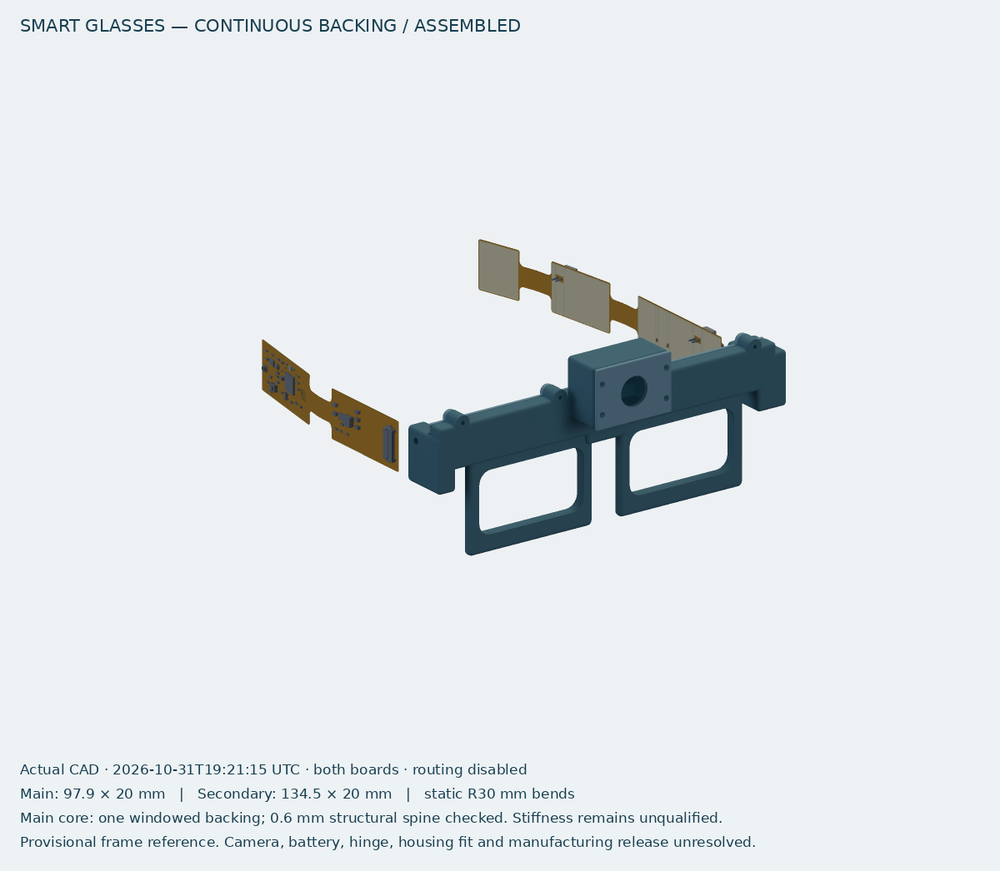

# smart-glasses

**WORK IN PROGRESS — unrouted flex-board study and separate camera-carrier review.**
The glasses study has two independent populated flex boards with static temple
curvature and provisional stiffened islands. The standalone OV5640 AF carrier is
**not connected to either board or fitted into the frame**. No battery assembly
is selected. Routing, flex fabrication data, thermal/RF/hinge testing and physical
fit/function remain unresolved; this is not a manufacturing-ready wearable.

The default tsCircuit preview is the [main flex board](src/flex/main-flex.circuit.tsx).
The [secondary flex board](src/flex/secondary-flex.circuit.tsx),
[standalone camera carrier](src/camera-carrier/camera-carrier.circuit.tsx) and
[earlier fixed-open enclosure](src/enclosure/glasses-enclosure.circuit.tsx) are
separate gallery entries. The earlier enclosure contains the rigid baseline and
is not a fitted housing for the flex boards or new camera carrier. The original
rigid main/secondary entrypoints remain in source for regression and comparison.

Actual combined flex progress view (provisional front frame, no fitted temples,
battery, camera or hinge cable):



The **58 × 18 × 0.8 mm standalone camera carrier** has three controlled rails,
direction-controlled signal translation and a host-tested sequence contract.
AF power, host controls/voltage monitoring, connector manufacturing qualification,
OV5640 initialization and frame integration remain gates. Its own
[assembled](docs/progress/2026-10-31-camera-carrier-assembled.png) and
[exploded](docs/progress/2026-10-31-camera-carrier-exploded.png) views show only
that independent review board.

See [flex study](docs/flex-adaptation.md), [camera-carrier review](docs/camera-carrier-review.md),
[compact component review](docs/compact-assembly-review.md) and
[November publication scope](docs/publication-2026-11-02.md). RRC1120 was rejected
for wearable fit. CMB battery candidates have unverified assembled dimensions,
continuous ratings, NTC and sample availability; supplier questions remain unsent.

The electronics retain **ESP32-S3R8**, external **8 MB flash** and in-package
**8 MB PSRAM**, ICS-43434 microphone, U.FL antenna interface and TPS63070 regulator.
The secondary board retains the BQ24075T charger, hardware switch, gauge,
MAX98357A amplifier and touch input. Muse/cloud processing remains the intended
assistant path. No physical assembly, flashing, camera image or wearable function
has been demonstrated. Supplier observations are dated catalog checks, not an
assembly allocation; see [core sourcing](docs/core-sourcing.md) and
[boot/memory review](docs/boot-memory-review.md).

The earlier [enclosure CAD and printable prototypes](mechanical/glasses/README.md)
and [rigid-board review](docs/compact-design.md) remain available for comparison.
The WROOM baseline is preserved at `codex/wroom-power-baseline` (`c45edaa`).

## Intended features

- User-triggered photo capture and microphone input.
- Push-to-talk voice interaction and a miniature speaker response.
- 2.4 GHz Wi-Fi, BLE setup/control and smartphone connectivity.
- Muse personal-agent processing through a connected cloud session.
- One protected rechargeable LiPo battery.
- Capture/talk button, touch input, physical power control and a visible recording indicator.

Continuous video, always-listening wake words, standard Bluetooth headset calls, and
consumer-frame fit are not established by this prototype plan.

## Hardware architecture

| Board | Implemented schematic blocks | Open items |
| --- | --- | --- |
| Left | S3R8 +8 MB flash, TPS63070, ICS-43434, capture button/LED driver, U.FL and FH12 connector | Exact camera, RF matching/layout, sourcing and measured fit |
| Right | BQ24075T, TPS22965 hardware switch, MAX17048, MAX98357A, AT42QT1010, JST and FH12 connectors | Selected cell/attached NTC, speaker/electrode/enclosure, input protection and thermal release |

The [BOM](bom/preliminary-bom.csv) reflects generated components; the
[verified recommendation](docs/recommended-bom.md), [complete catalog audit](bom/component-audit.json)
and [CSV](bom/jlcpcb-recommendation.csv) record current JLC/LCSC stock and process gates.
Earlier [LCSC observations](bom/sourcing-checks.json) remain available for comparison.
Catalog observations are availability checks, not orders or reservations.
All imported geometry still needs assembly review, including thermal vias and paste.

## Communication between PCBs

Four VSYS contacts and eight ground returns share the 20-contact connector with the
left-regulated `VCORE3V3`, audio clocks/data, control I2C, touch and amplifier enable.
The [pin contract](docs/pin-mapping.md) is checked against both generated netlists.
Physical cable contact side, orientation, voltage drop and hinge life remain unverified.
The camera stays local to the left; battery and bridge speaker outputs stay on the right.

## Smartphone, Muse and cloud architecture

The official [Muse Gadgets SDK](https://github.com/facebookincubator/muse-gadget-sdk)
provides a path for custom ESP32 and Linux hardware to join the user's personal Muse.
Its S3 DevKitC profile explicitly includes WROOM-1U-N8R8. This supports the initial module
choice as a firmware starting point. Our initial peripheral port is in `firmware/`;
board layout and hardware validation are still pending.

The Muse app performs developer-mode pairing, while the glasses' Wi-Fi client maintains
the runtime connection. The agent runs remotely. A separate phone media-relay architecture
would be extra work and is not assumed to be part of the SDK. A working internet/hotspot
path, SDK token and eligible real account must be demonstrated on a bench board.

The initial target is record question → transmit audio/photo → Muse processes it → receive
and play a response, with recording status shown during capture. Prove actual photo upload;
SDK features that display images received from Muse do not establish camera support.
Read [Muse integration and supported hardware](docs/muse-integration.md) for setup prerequisites.
The [camera/audio integration plan](docs/peripheral-integration.md) records the reviewed SDK
paths, shared-clock bus, power constraints and remaining custom-port work.

The media baseline is I2S0 at **16 kHz with two 32-bit wire slots** for ICS-43434 and
MAX98357A, plus a separate LCD_CAM/DVP OV2640 interface. The SDK's realtime session
resamples to/from 24 kHz network audio; MAX98357A does not accept 24 kHz LRCLK. Ordinary
voice-note replies currently return text, so spoken output needs an admitted experimental
realtime voice session or an explicit TTS integration. The initial firmware adds OV2640
capture commands and the original displayless INMP441/MAX98357A audio backend. The
current circuit uses ICS-43434; this hardware combination remains bench-unverified. See
[firmware setup and limitations](firmware/README.md) and [build checks](docs/firmware-validation.md).

## Electrical decisions that remain open

- Exact camera module/lens/connector and its power/reset sequence.
- Measured frame envelope; actual battery, speaker and antenna assembly.
- JLC assembly availability and low crystal stock; clock/RF/memory-rail/thermal validation.
- Protected cell and genuine battery-attached NTC; charge remains disabled by default.
- Final input protection, cable current/continuity/hinge validation, routing and manufacturing review.

ESP32-S3 supports BLE, not classic A2DP/HFP headset audio. See the
[current circuit review](docs/compact-design.md) for the electrical limits and release gates.

## Repository layout

```text
smart-glasses/
├── README.md
├── package.json
├── package-lock.json
├── tsconfig.json
├── tscircuit.config.json
├── .npmrc
├── .nvmrc
├── .gitignore
├── src/
│   ├── main-board/main-board.circuit.tsx
│   ├── secondary-board/secondary-board.circuit.tsx
│   └── components/power-rail-scaffold.tsx
├── imports/                        # JLCPCB components imported by tsci
├── firmware/                       # pinned SDK port; see its README
├── scripts/check-boards.mjs
├── docs/
│   ├── architecture.md
│   ├── hardware-requirements.md
│   ├── pin-mapping.md
│   ├── mechanical-constraints.md
│   ├── development-roadmap.md
│   ├── muse-integration.md
│   ├── peripheral-integration.md
│   ├── proposed-gpio-map.csv
│   ├── main-board-core.md
│   ├── firmware-validation.md
│   ├── research-sources.md
│   └── validation.md
├── bom/preliminary-bom.csv
└── assets/README.md
```

`node_modules/`, `dist/`, `checks/` and caches are generated/ignored. The local `.git/`
is initialized separately. The public GitHub repository is
[**rushabhcodes/smart-glasses**](https://github.com/rushabhcodes/smart-glasses).
The npm package remains private; no npm or tsCircuit-registry publication is configured.

## Development setup

Use **Node.js 24.x**, npm, and **Bun 1.3.3 or later** on PATH. Bun is required by the installed
tsCircuit CLI's launcher even when npm manages packages. `.nvmrc` specifies Node 24; if
using nvm, run `nvm use`. The host originally had Node 26; see validation notes for warnings.

```sh
git clone https://github.com/rushabhcodes/smart-glasses.git
cd smart-glasses
npm ci --allow-remote=all
npm run validate
npm run render
```

The per-command `--allow-remote=all` is needed on this host because the dependency tree
includes a tarball from tsCircuit's JS CDN and the host npm configuration blocks URL
packages by default. The lockfile records its resolved URL/integrity. No global npm settings
were changed. `.npmrc` retains the official `@tsci` component registry configuration.

This repository was bootstrapped with official `tsci init -y --no-install`, then adapted for
two source entries. Versions are exact and locked; no global tsCircuit install is needed.
TypeScript 5.9.3 satisfies tsCircuit's declared 5.x peer range. Strict checking remains enabled;
ESNext libraries and Node types are needed by the published toolchain declarations.

| Direct dependency | Version | Role |
| --- | --- | --- |
| react | 19.3.1 | Circuit JSX runtime |
| tscircuit (dev) | 0.0.3033 | tsci CLI, evaluator and real circuit primitives |
| typescript (dev) | 5.9.3 | Type checking |
| @tscircuit/props (dev) | 0.0.712 | Types used by JLCPCB-imported components |
| @types/react (dev) | 19.3.0 | React/JSX types |
| @types/node (dev) | 24.10.0 | Node globals referenced by toolchain types |

Firmware dependencies live in the existing `firmware/` subtree and its local caches.
They remain separate from npm. ESP-IDF and a Muse token are not needed to edit these
tsCircuit hardware files; a token is required later for actual device pairing.

## Development and review commands

| Command | Behavior |
| --- | --- |
| `npm run dev` or `npm run dev:main` | Main-board preview on port 3020 (or CLI-selected free port) |
| `npm run dev:secondary` | Secondary-board preview on port 3021 |
| `npm run typecheck` | Strict TypeScript check, no emitted JS |
| `npm run check:netlist` | Check both independent board netlists |
| `npm run check:schematic` | Check schematic placement for both boards |
| `npm run check:placement` | Check PCB placement for both boards |
| `npm run check:source` | Check source diagnostics for both boards |
| `npm run build` | Build both Circuit JSON outputs with routing disabled |
| `npm run render` | Generate schematic/PCB SVG and PNG previews for both |
| `npm run check:main-core` | Verify generated physical-pad connectivity, supplier IDs and reserved pins |
| `npm run check:peripherals` | Generated right-board and cable/power/interface invariants |
| `npm run validate` | Typecheck → netlist → schematic/PCB placement → independent builds → both physical-pin guard suites |

Per-board `build:main`, `build:secondary`, `render:main` and `render:secondary` scripts are
also available. Every command supplies the source path explicitly; `tscircuit.config.json`
sets the main board as the default for direct CLI invocations. Two `<board>` roots are never
merged into one board. Shared TSX components are helpers, not additional circuit entries.

Build/render outputs are under `dist/`, with per-entry directories reported by the CLI.
Review both schematic and PCB images after changes. The script wrapper propagates CLI
failure and treats reported schematic placement issues as failures even if the CLI returns 0.
Passing checks covers the implemented compact review circuits on both boards. It does not
validate the unresolved camera, measured supply/RF performance, enclosure fit or physical hardware.

No routing/shorts/manufacturing release check is claimed while copper routing is disabled.
Manufacturing release remains gated. When functional circuitry is reviewed and routing begins,
add routing/shorts/fabrication checks appropriate to the actual implementation.

## Incremental implementation workflow

1. Build the displayless media port and prove Muse pairing, realtime/TTS spoken responses
   and actual OV2640 JPEG delivery on the exact bench hardware.
2. Measure frame, antenna/camera space, power peaks, battery/runtime and thermal constraints.
3. Select exact components, review footprints/pins and freeze the cable/GPIO contracts.
4. Replace TODOs with one verified subsystem at a time; keep board entries independent.
5. Re-run netlist and placement checks and inspect renders before proceeding to routing.

The full [development roadmap](docs/development-roadmap.md) defines exit criteria.
[Current validation results](docs/compact-validation.md) records the checks actually run and upstream issues.
[Source register](docs/research-sources.md) links the evidence for technical assumptions.

## Firmware build (no flashing)

```sh
npm run firmware:bootstrap
npm run firmware:build
npm run firmware:test
npm run firmware:size
```

ESP-IDF and its Python/toolchain dependencies are separate from the npm/tsCircuit stack.
The scripts keep downloads in ignored repository-local caches and accept no flash target.
The checked-in profile has no credentials; real Muse pairing remains a future bench task.
See [firmware documentation](firmware/README.md) for source layout, pins and controls.

## Hardware work in tsCircuit

Start the left-board editor with `npm run dev:main` and the right-board editor with
`npm run dev:secondary`. The left entry now uses checked-in JLCPCB imports in `imports/`.
The module's generated symbol needed pin-map corrections; preserve the review recorded
in [main-board core](docs/main-board-core.md) when re-importing. Run `npm run validate`
after schematic changes, then `npm run render:main` to regenerate the visual review.
Do not treat a successful firmware or tsCircuit build as physical hardware validation.
