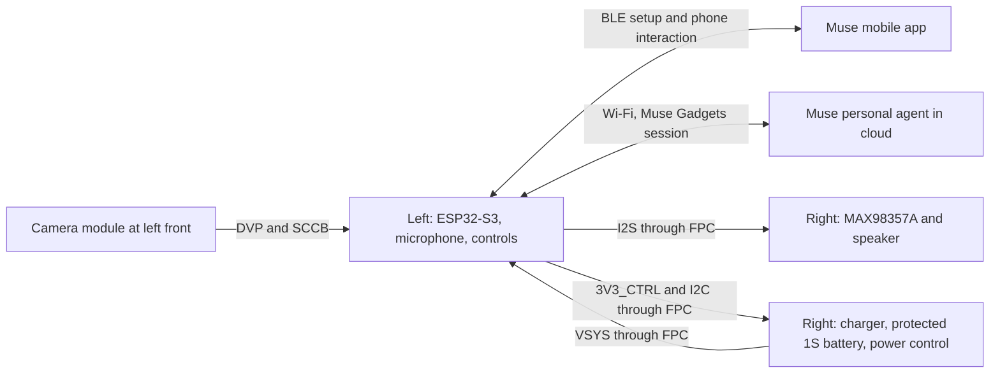

# System architecture

Status: research scaffold, 2026-10-28. All ICs and connector choices remain candidates.
The intended assistant is **Meta's Muse personal agent through the Muse Gadgets SDK**.
No AI model runs on either temple PCB. See [Muse integration](muse-integration.md).
The selected media approach is detailed in [peripheral integration](peripheral-integration.md):
shared I2S0 audio at 16 kHz and a separate LCD_CAM/DVP camera backend. These are reviewed
engineering proposals with an initial [compile-tested firmware port](../firmware/README.md);
physical media behavior is not bench-validated.

## Functional partition

This is the proposed block architecture, not a completed schematic or a tested SDK port.
The right board has no second MCU. Its digital interfaces are driven by the left MCU.

## Left PCB responsibilities

- ESP32-S3 manages Wi-Fi, BLE, Muse session, camera capture and application state.
- Capture JPEG photographs over the camera's parallel DVP interface; configure through SCCB.
- Sample the local INMP441 and handle the physical talk/capture button in a custom displayless port.
- Share I2S0 BCLK/LRCLK between microphone and amplifier at 16 kHz, two 32-bit wire slots.
  Keep microphone SD local; send the clock pair and speaker data through the FPC.
- Poll right-board battery state over I2C; optional gauge/charger alert GPIOs are omitted.
- Convert VSYS to 3V3_MAIN; derive camera-specific rails only after the module is selected.
- Control a visible recording indicator and provide reset, boot and wired programming access.
- Use the WROOM-1U external antenna connector with a separately selected antenna and cable.

## Right PCB responsibilities

- Accept controlled charging power at dock contacts and manage one protected LiPo pack.
- Separate charger BAT and OUT nodes; provide a switched system rail after power-path management.
- Measure battery state with a gauge referenced to the protected pack terminals.
- Drive one miniature speaker through a bridge-output Class-D amplifier.
- Provide the touch electrode/controller, physical power control, and system status signals.
- Keep high-current charging/speaker loops local; provide adequate ground returns through the FPC.

## Proposed power domains

| Rail | Source | Loads and constraints |
| --- | --- | --- |
| CHARGE_5V | External current-limited dock | Charger input only; voltage/current and contact protection TBD |
| VBAT_PROTECTED | One protected 4.2 V-charge 1S LiPo | Charger BAT and gauge; never bypass the pack protection |
| VSYS_UNSWITCHED | BQ24074 OUT | Follows battery without input; approximately 4.4 V regulated with input |
| VSYS | Hardware-controlled downstream switch | FPC to main regulator and local amplifier; switch topology TBD |
| 3V3_MAIN | Left buck-boost | ESP32-S3, microphone and selected low-voltage logic |
| 3V3_CTRL | FPC return from 3V3_MAIN | Right touch logic and I2C pull-ups; review return current and off-state leakage |
| Camera rails | TBD from selected module | A bare camera sensor must not be assumed to accept a single 3.3 V supply |

VSYS must never connect directly to ESP32-S3 power or GPIO. The scaffold's VSYS/GND
capacitor and probe pads only exercise tsCircuit. They do not implement any rail source.

The candidate TPS63031 input range covers the proposed VSYS range, but its load capability
must pass a combined peak-current and transient test before selection. The amplifier uses
VSYS to avoid loading the small 3.3 V converter with speaker power. Provide local bulk and
high-frequency bypass capacitors, and review grounding, ripple and speaker EMI.

A physical power button needs a defined function: latching supply switch or a momentary
button plus a power-latch/load-switch circuit. Firmware sleep is not battery isolation.
Keep charging functional when the system is off. BQ24074 is not a complete cell protector.
Prevent powered gauge/status lines from back-powering switched-off MCU/control rails.

## Inter-board communication

The FPC carries system power, common ground, proposed 3.3 V control power, I2S TX,
I2C and GPIO controls. It does not carry RF, raw camera DVP, or speaker output in the
baseline. [Pin mapping](pin-mapping.md) defines signal roles; contact numbering is TBD.

Identical names on independently built boards do not create a physical cable or verify
continuity. Connector orientation and cable continuity must be reviewed at assembly level.

## Smartphone and cloud behavior

The Muse Gadgets SDK is the primary candidate integration, with BLE/app pairing and a
Wi-Fi session to the user's Muse. A custom smartphone audio/media relay is a separate
engineering option and is not assumed to be supplied by the Gadgets SDK. Hotspot behavior,
mobile-network availability, country/account eligibility and reconnection need testing.

Start with push-to-talk and occasional photos. Do not promise always-listening wake words,
continuous video, low-latency duplex audio, or headset-call compatibility. The first firmware
proof must demonstrate pairing, audio input, spoken reply playback and photo delivery to
the actual personal agent, with the visible recording indicator synchronized to capture.

## ESP32-S3 audio limits

ESP32-S3 has digital I2S interfaces; use an external amplifier/DAC for the speaker path.
It supports BLE, without Bluetooth Classic/A2DP/HFP or standard LE Audio. Ordinary
phone headset audio therefore cannot be the transport assumption. A custom Wi-Fi audio
path and SDK-specific voice session need separate implementation and measurement.

The INMP441 and MAX98357A use one shared-clock I2S0 TX/RX bus in the proposed baseline.
The microphone requires 64 BCLK per frame; 16 kHz with two 32-bit wire slots yields 1.024 MHz.
The SDK exposes PCM16 mono. Its existing Guition adapter is an INMP441 integration reference;
our initial port now supplies INMP441/MAX98357A hooks and a displayless application path.
Power/sleep lifecycle and hardware validation remain open.

The SDK realtime path converts 16 kHz device audio to/from 24 kHz network audio. Keep those
rates distinct: MAX98357A does not support 24 kHz LRCLK. Ordinary voice notes currently return
text, so spoken replies require an admitted experimental realtime voice session or explicit TTS.

LCD_CAM handles the OV2640 separately from I2S. Our port adds an Espressif camera-driver
backend and independent camera.capture advertisement/dispatch. Memory, DMA and
Wi-Fi contention still require load testing. Begin with a single bounded QVGA JPEG and separate
media experiments. Use application-level half-duplex speech: one mic has no array beamforming
or hardware echo cancellation. See [peripheral integration](peripheral-integration.md) for
specific rates, supply/SD_MODE checks and acceptance gates.

Sources: [Espressif module](research-sources.md#hardware),
[ESP-IDF I2S and camera](research-sources.md#firmware),
[charger/amplifier](research-sources.md#hardware), and the Muse SDK links in
[muse-integration.md](muse-integration.md).
